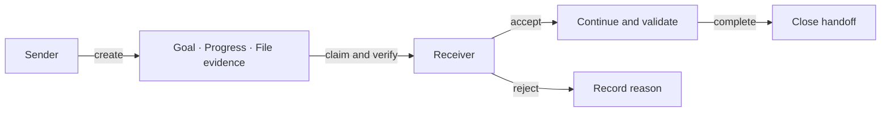

# Agent Handoff

**Verifiable task handoffs for coding agents.**

[](pyproject.toml)
[](LICENSE)
[](CHANGELOG.md)

[Quick start](#quick-start) · [Use cases](#use-cases) · [How it works](#how-it-works) · [Documentation](#documentation) · [中文](README.md)

A patch needs another pair of eyes. A debugging session has stalled. An unfinished task needs to move to a new session or tool.

Agent Handoff saves the **goal, progress, decisions, next steps, files and validation records** in a structured package. The receiving agent claims it, checks Git and file evidence, then accepts or rejects the handoff. Use CLI or MCP tools in your existing workflow. Data stays local, and the handoff service requires no LLM API key.

## Why Agent Handoff?

- **Explain the work in progress.** Keep completion criteria, finished work and open questions together, with a readable Markdown export.
- **Check which code arrived.** Capture Git HEAD and SHA-256 hashes of listed files; detect changed, missing or mismatched evidence before continuing.
- **Track who has taken over.** Persist claims, leases, acceptance, rejection and completion alongside their events.
- **Use your existing tools.** CLI and stdio MCP share a SQLite database without depending on a model provider.

<a id="quick-start"></a>

## Quick start

Requires Python 3.10+ and Git. From a downloaded source checkout on macOS or Linux:

```bash
python3 -m venv .venv
source .venv/bin/activate
python -m pip install -e .
python scripts/demo_handoff.py --output demo-output
```

The demo creates a separate pagination project. The sender fixes rounding and leaves failing tests. The receiver verifies the evidence, adds input checks, runs the tests and completes the task. The result includes:

```json
{
  "kind": "scripted-demo",
  "sender_test_exit": 1,
  "receiver_test_exit": 0,
  "status": "completed"
}
```

Read `demo-output/handoff.md` for the handoff and `demo-output/receiver-tests.log` for the final checks. The output directory must not exist; choose a new directory for another run.

The demo uses deterministic scripts for both roles, without calling a real agent. [Walkthrough and manual continuation →](docs/DEMO.md)

<a id="use-cases"></a>

## Use cases

| Workflow | What gets handed over | What the receiver does |
|---|---|---|
| **Implementation → independent verification** | Patch references, acceptance criteria, known risks and validation records | Check the review target, rerun relevant checks and record findings |
| **Debugging → a fresh agent** | Reproduction steps, failure output, ruled-out hypotheses and relevant files | Reproduce the failure, then continue from the remaining questions |
| **Session or tool switch** | Progress, unfinished changes, decisions and next steps | Resume in the shared workspace with explicit task context |

The current scope is **one trusted local user sharing a database and workspace**. Different clients must be configured separately; real client-to-client workflows remain to be validated. [Recipes and priorities →](docs/USE_CASES.md)

<a id="how-it-works"></a>

## How it works



Packages contain file references; v2 capture also records bounded diffs and check logs. CLI and MCP creation calculate hashes through the shared core.

Edit [the example package](examples/handoff.json) with your actual task and workspace-relative file paths:

```bash
# Sender: keep the id returned by create.
agent-handoff create examples/handoff.json --workspace . --markdown handoff.md

# Receiver: replace HANDOFF_ID with that id.
agent-handoff claim HANDOFF_ID --agent agent-b
agent-handoff show HANDOFF_ID --markdown
agent-handoff verify HANDOFF_ID --workspace .

# After inspecting the code, rerunning relevant checks and choosing to proceed:
agent-handoff ack HANDOFF_ID --agent agent-b --accept
# After actually completing the task described in the package:
agent-handoff complete HANDOFF_ID --agent agent-b
```

Reject with `agent-handoff ack HANDOFF_ID --agent agent-b --reject --reason 'specific reason'`.
[States, leases and format →](docs/PROTOCOL.md)

## Connect your agent

```bash
python -m pip install -e '.[mcp]'
```

Configure your MCP client to launch the virtual environment's `agent-handoff-mcp` executable. Give both agents the same `HANDOFF_DB_PATH`.
The [integration guide](docs/INTEGRATIONS.md) covers MCP configuration, CLI usage and troubleshooting. Use the [sender and receiver instructions](examples/agent-instructions.md) as a starting point.

## Project status

**0.1.0a1 / Alpha.** Install from source; no PyPI release has been published. CLI and MCP have local regression checks. Improvements to real-agent handoff efficiency still need [controlled evaluation](docs/EVALUATION.md).

- The `create` workflow above verifies Git HEAD and explicitly listed files. Validation records are sender claims; receivers should rerun checks. `verify` never executes recorded commands.
- The v1 example retains its original acceptance policy. The v2 capture workflow requires a successful verification receipt. Agent IDs are labels, not authentication.
- Default data lives in `~/.local/share/agent-handoff/memory.db`. See [data management](docs/DATA.md) for configuration, backups, export and retention.

A client's built-in resume may be sufficient for continuing its own session. Agent Handoff is useful when you need an explicit work package, file checks and a receiving state.

<a id="documentation"></a>

## Documentation

| I want to… | Read |
|---|---|
| Run a complete example | [Handoff demo](docs/DEMO.md) |
| Choose a workflow | [Use cases and priorities](docs/USE_CASES.md) |
| Connect a coding tool | [MCP / CLI](docs/INTEGRATIONS.md) |
| Customize a package | [Protocol](docs/PROTOCOL.md) · [JSON Schema](docs/handoff.schema.json) |
| Manage local data | [Storage and upgrades](docs/DATA.md) |
| See what comes next | [Roadmap](PLAN.md) · [Changelog](CHANGELOG.md) |

## Contributing

Reproducible bugs, integration experiences and real handoff failures are welcome. See [CONTRIBUTING.md](CONTRIBUTING.md) for setup, tests and the PR process, and [SECURITY.md](SECURITY.md) for security reports.

We especially welcome trials of implementation-to-verification handoffs that record preparation effort, missing context and validation results. Detailed guides are currently primarily in Chinese; translation contributions are welcome.

## License

[MIT](LICENSE)
