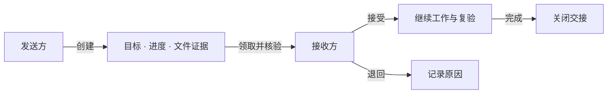

# Agent Handoff

**为编程 agent 提供可核验的任务交接。**

[](pyproject.toml)
[](LICENSE)
[](CHANGELOG.md)

[快速开始](#quick-start) · [应用场景](#use-cases) · [工作原理](#how-it-works) · [文档](#documentation) · [English](README.en.md)

代码改到一半，需要换个会话继续；实现已经完成，需要另一个 agent 复验；排障卡住了，需要把已排除的原因和失败现场交给下一位。

Agent Handoff 将**目标、进度、决策、下一步、文件与验证记录**保存为结构化交接包。接收方领取后核对 Git 版本和文件摘要，再决定接受或退回。通过 CLI 或 MCP 接入现有工作流，数据保存在本地，无需 LLM API key。

## 为什么使用 Agent Handoff？

- **交清楚正在做什么**：完成标准、已完成工作与待解决问题有各自的位置，也能导出为人可读的 Markdown。
- **核对拿到的是哪份代码**：创建时记录 Git HEAD 与所列文件的 SHA-256，接手时发现版本变化、文件缺失或内容改变。
- **明确谁已经接手**：领取、租约、接受、退回和完成都有持久状态与事件记录。
- **沿用你的开发工具**：CLI、stdio MCP 和本机 HTTP API 共用一个 SQLite 数据库，不绑定模型提供商。

<a id="quick-start"></a>

## 快速开始

新增：支持[自动采集工作现场、实测检查与强制核验记录](docs/EVOLUTION.md)。
MCP 推荐使用 `handoff_capture`，CLI 使用 `create --capture`；旧创建入口继续兼容 v1。

需要 Python 3.10+ 和 Git。以下命令适用于 macOS / Linux，在下载的源码目录中运行：

```bash
python3 -m venv .venv
source .venv/bin/activate
python -m pip install -e .
python scripts/demo_handoff.py --output demo-output
```

演示会创建一个独立的分页函数项目：发送方修复取整问题并留下失败测试，接收方核验后补齐输入检查，再运行测试并完成交接。输出结果包含：

```json
{
  "kind": "scripted-demo",
  "sender_test_exit": 1,
  "receiver_test_exit": 0,
  "status": "completed"
}
```

打开 `demo-output/handoff.md` 查看交接内容，`demo-output/receiver-tests.log` 查看修复后的验证。输出目录须不存在；再次运行时换一个新目录。

此演示用脚本模拟双方操作，不调用真实 agent。[分步演示与人工接手 →](docs/DEMO.md)

<a id="use-cases"></a>

## 应用场景

| 场景 | 交接内容 | 接收方要做什么 |
|---|---|---|
| **实现 → 独立复验** | 待审改动、完成标准、已知风险、验证记录 | 核对待审版本，运行关键检查，给出可复查的结论 |
| **排障 → 新 agent 接手** | 复现条件、失败输出、已排除假设、相关文件 | 先复现失败，再从剩余问题继续调查 |
| **会话或工具切换** | 当前进度、未完成修改、关键决策、下一步 | 在同一工作区接手，减少手动整理上下文 |

当前适用于**同一可信本机用户、共享数据库和工作区**的交接。跨客户端使用需要分别配置连接；客户端组合尚待真实会话验证。
[场景选择、操作示例与落地优先级 →](docs/USE_CASES.md)

<a id="how-it-works"></a>

## 工作原理



交接包保存文件引用；v2 自动采集还包含所选改动的 diff 和有限检查日志，完整文件仍留在工作区。
CLI / MCP 创建时计算文件摘要；HTTP 创建时保存调用者提供的内容。

编辑 [交接包示例](examples/handoff.json)，填入真实目标和工作区内的相对文件路径：

```bash
# 发送方：创建交接，记下返回的 id。
agent-handoff create examples/handoff.json --workspace . --markdown handoff.md

# 接收方：将 HANDOFF_ID 替换为返回的 id。
agent-handoff claim HANDOFF_ID --agent agent-b
agent-handoff show HANDOFF_ID --markdown
agent-handoff verify HANDOFF_ID --workspace .

# 阅读代码、复验相关检查并决定接手后：
agent-handoff ack HANDOFF_ID --agent agent-b --accept
# 实际完成交接包中的任务后：
agent-handoff complete HANDOFF_ID --agent agent-b
```

需要退回时，运行 `agent-handoff ack HANDOFF_ID --agent agent-b --reject --reason '具体原因'`。
[状态、租约和格式说明 →](docs/PROTOCOL.md)

## 接入 agent

```bash
python -m pip install -e '.[mcp]'
```

让 MCP 客户端启动虚拟环境中的 `agent-handoff-mcp`，并为发送方、接收方设置同一个 `HANDOFF_DB_PATH`。
[接入指南](docs/INTEGRATIONS.md)提供 Codex 配置、HTTP 使用方法与常见故障；[指令模板](examples/agent-instructions.md)帮助 agent 生成和接收交接包。

## 项目状态

当前为 **0.1.0a1 / Alpha**，从源码安装，尚未发布到 PyPI。CLI、HTTP 和 MCP 协议入口已有本地回归验证；真实 agent 的接手效率仍待[对照实验](docs/EVALUATION.md)检验。

- 上述 `create` 流程核验 Git HEAD 与显式列出的文件；测试记录由发送方提供，接收方需复验。`verify` 不执行包中的命令。
- 上述流程默认由接收方决定接受，不强制要求先通过核验。`agent_id` 是标签，不是认证；HTTP 仅用于可信本机。
- 默认数据位于 `~/.local/share/agent-handoff/memory.db`。配置、备份、导出和清理见[数据维护](docs/DATA.md)。

如果只需恢复同一客户端的会话，原生恢复功能可能更直接；如果需要明确的交接内容、代码核验与接收状态，再考虑使用本项目。

<a id="documentation"></a>

## 文档

| 我想…… | 文档 |
|---|---|
| 跑一个完整例子 | [交接演示](docs/DEMO.md) |
| 选择落地场景 | [场景与优先级](docs/USE_CASES.md) |
| 接入编程工具 | [MCP / CLI / HTTP](docs/INTEGRATIONS.md) |
| 自定义交接包 | [格式与状态](docs/PROTOCOL.md) · [JSON Schema](docs/handoff.schema.json) |
| 管理本地数据 | [存储与升级](docs/DATA.md) |
| 了解后续方向 | [路线图](PLAN.md) · [变更日志](CHANGELOG.md) |

## 参与贡献

欢迎提交最小复现、客户端接入经验和真实交接失败案例。开发环境、测试与 PR 流程见 [CONTRIBUTING.md](CONTRIBUTING.md)；安全问题见 [SECURITY.md](SECURITY.md)。

尤其欢迎试用“实现 → 独立复验”流程，并记录交接准备时间、遗漏信息和复验结果。

## 许可证

[MIT](LICENSE)
# agent_memory_share
